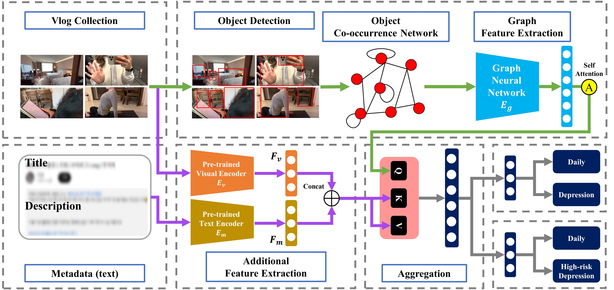
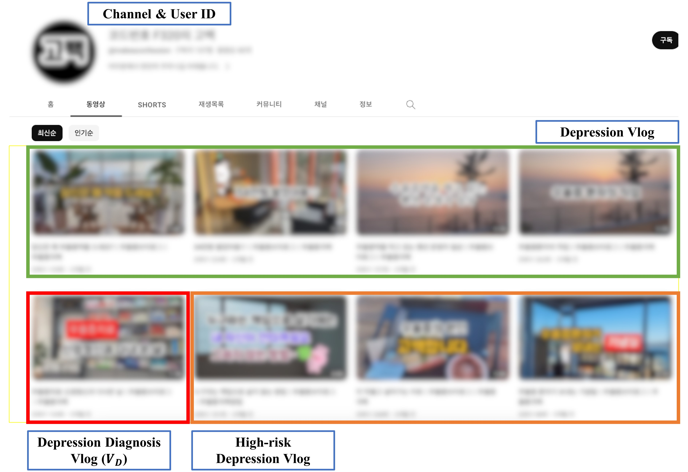

# MOGAM: Multimodal Object-oriented Graph Attention Model for depression detection in vlogs

Code for *Object-level representations for multimodal depression detection in vlogs: a vlog dataset and a representation analysis* (submitted to DIGITAL HEALTH).

MOGAM represents a vlog by an **object co-occurrence graph**: each of the 80 COCO classes is a node, and two classes are connected in proportion to how often they are detected in the same frame. A two-layer graph attention network encodes the graph, and the result is fused with visual (ResNet), textual (KoBERT title and description) and duration features through a learned gate. This repository contains the graph construction, the model, and the training protocol that produce the main results of the paper.

## Workflow



**Figure: from data collection to classification.** Frames are sampled at 1 fps, objects are detected with YOLOv5x, and each vlog becomes an 80-node co-occurrence graph that is encoded by a GAT and fused with the visual, title, description and duration features.

## Results (five seeds, 80/10/10 splits redrawn per seed)

| Task | Accuracy |
|---|---|
| Daily vs. depression | 0.893 ± 0.016 |
| Daily vs. high-risk | 0.903 ± 0.015 |
| Three-class | 0.785 ± 0.013 |

Removing the graph from the full model costs 2.1 and 2.5 accuracy points on the two binary tasks; see the paper for the modality ablation, the representation analysis and the robustness controls.

## Data

We collected vlogs from YouTube with two hashtags, #일상브이로그 (daily vlog) and #우울증브이로그 (depression vlog). For the depression hashtag we collected every vlog on each channel, and two annotators identified the earliest vlog in which clinical care becomes visible (the reference vlog). Vlogs posted before it form the high-risk group and vlogs posted from it onwards form the depression group; daily vlogs come from channels unrelated to depression. The corpus consists of 4,749 Korean YouTube vlogs from 1,135 users.

| Group | Vlogs | Mean duration |
|---|---|---|
| Daily | 1,877 | 903.4 s |
| High-risk | 642 | 515.7 s |
| Depression | 2,230 | 416.0 s |



**Figure: data example (YouTube channel).** A channel's timeline is split at the reference vlog into high-risk (before) and depression (from the reference vlog onwards).

**The object co-occurrence graphs, the extracted visual and metadata features, and the group assignments are available from the corresponding author on request** (jycha95@g.skku.edu). Source videos, frames, titles, descriptions and channel identifiers are not redistributed, because the disclosing groups consist of identifiable individuals. The released files are de-identified: video and channel identifiers are replaced by random keys.

Place the released files as follows:

```
data/
  labels.csv              id,group,channel        group in {daily, high_risk, depression}
  graphs/<id>.npy         (80, 80) float32 co-occurrence matrix, normalised by frame count
  features/<id>.npz       visual (1000,), title (768,), description (768,), duration (1,)
```

`channel` is an anonymised channel key and is used only for the user-disjoint split.

## Installation

```
pip install -r requirements.txt
```

PyTorch and PyTorch Geometric should be installed for your CUDA version first (see their install pages).

## Usage

```
# main result, daily vs. depression (gate fusion, all modalities, seeds 0-4)
python -m mogam.train --data data --task daily_vs_depression

# daily vs. high-risk (the transformer fusion was selected on validation for this task)
python -m mogam.train --data data --task daily_vs_highrisk --fusion transformer

# three-class
python -m mogam.train --data data --task three_class

# ablation: drop the graph
python -m mogam.train --data data --task daily_vs_depression --mods visual,title,desc,dur

# robustness: channel-disjoint split
python -m mogam.train --data data --task daily_vs_depression --user-disjoint
```

Each run prints per-seed validation and test accuracy and writes a JSON summary to `results/`.

## Building graphs for new videos

```python
from mogam.graph_construction import cooccurrence_graph, from_yolo_results
sets = from_yolo_results(per_frame_yolo_outputs, conf=0.70)   # frames sampled at 1 fps
A = cooccurrence_graph(sets)                                    # (80, 80), save with np.save
```

Frames were sampled at one per second and detected with YOLOv5x (COCO weights) at a confidence threshold of 0.70. Visual features are the 1000-d ImageNet logits of a ResNet averaged over frames; title and description are `skt/kobert-base-v1` [CLS] embeddings; duration is the video length in seconds (the model applies log1p).

## Repository layout

```
mogam/coco.py                 COCO class list (node order)
mogam/graph_construction.py   Eq. 1: per-vlog co-occurrence matrix from frame-level detections
mogam/data.py                 loading the released files, task definitions, splits
mogam/model.py                GAT encoder + gated multimodal fusion
mogam/train.py                training and evaluation protocol
```

## Citation

Citation details will be added on publication.
